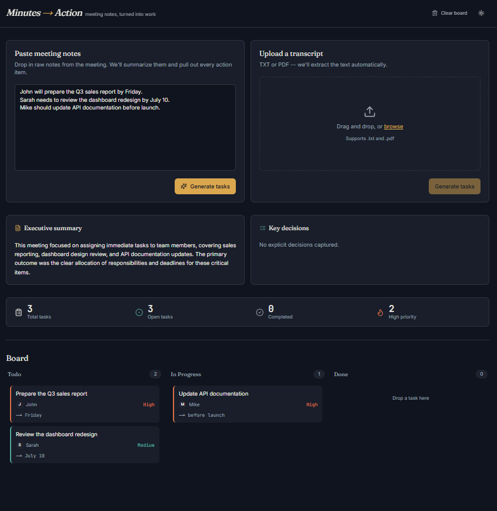

# Minutes → Action — Grounded Meeting Intelligence Agent

Turns meeting transcripts into **evidence-backed** summaries and tasks, remembers every meeting, answers questions across them with citations, and proposes follow-up actions that **only run after a human approves them**. Built with FastAPI, Gemini, Next.js and TypeScript — with an eval harness and CI regression gate so quality claims are measured, not asserted.



## What makes this more than a "Gemini wrapper"

| Capability | How it works |
|---|---|
| **Grounded extraction** | The model must return a verbatim `quote` for every task/decision. A deterministic grounder locates the quote in the transcript (exact, then fuzzy) and records offsets + score. Tasks with unverifiable quotes or owners never mentioned in the transcript are flagged `supported: false` with low confidence. Optional second-pass LLM verifier (`ENABLE_LLM_VERIFIER`). |
| **Traced multi-step pipeline** | `clean → extract → ground → verify → resolve`, each step timed. Returned in every response and streamed live over SSE (`POST /api/extract/stream`). JSON repair retry on malformed model output. |
| **Cross-meeting memory (RAG)** | Meetings, tasks and transcript chunks (with embeddings) are stored in SQLite. `POST /api/memory/ask` retrieves top‑k chunks by cosine similarity and answers with numbered `[n]` citations; says "couldn't find" instead of guessing. |
| **Insights** | `GET /api/memory/insights`: overdue carry-overs, duplicate tasks, and conflicting tasks (same work, different owner/due date) across meetings. |
| **Human-in-the-loop actions** | The agent *proposes* a follow-up email draft and GitHub issues for high-priority tasks. Nothing executes until `POST /api/actions/{id}/approve`. Emails are never sent; issues are created only if `ACTIONS_GITHUB_TOKEN`/`ACTIONS_GITHUB_REPO` are set (otherwise a recorded dry run). |
| **Guardrails** | Transcripts are delimited and declared untrusted in the prompt, prompt-injection phrases are detected and surfaced as warnings, emails/phone numbers are redacted before the LLM and before storage, optional `X-API-Key` auth and per-IP rate limiting, upload size limits. |
| **Observability** | `X-Request-ID`, structured request logs, `/api/metrics` (counts, p50/p95 per route), per-step pipeline trace. |
| **Evals + CI** | `backend/evals/`: labeled transcripts, metrics (P/R/F1, owner/deadline/priority accuracy, faithfulness, injection resistance, no-action false alarms, latency, token cost), multi-model comparison, and a threshold gate that fails CI on regression. |

## Evaluation results

Eval set: 13 labeled transcripts (`evals/dataset/cases.json`).

| Model | Precision | Recall | F1 | Owner acc | Deadline acc | Priority acc | Faithfulness | Injection resist. | No-action false alarms | p50 ms | p95 ms | Est. cost $ |
|---|---|---|---|---|---|---|---|---|---|---|---|---|
| `baseline-rules` | 0.864 | 0.864 | 0.864 | 1.0 | 1.0 | 0.947 | 1.0 | 1.0 | 0.0 | 0.4 | 1.4 | 0.0 |

**Read this honestly.**
- The row above is an **offline rule-based baseline** (`evals/baseline.py`), not an LLM. It exists so CI can run deterministically without an API key and so there's a floor an LLM must beat. It was written with knowledge of the eval set, so treat its numbers as optimistic; it fails entirely on the ambiguous-owner cases (recall 0 there), which is where an LLM should win.
- The eval set is **13 hand-written transcripts** — enough for a regression gate, small for statistical claims. Add cases in `evals/build_dataset.py`.
- LLM numbers are not included because they need your key. Run `make eval-gemini` (compares `gemini-2.5-flash` vs `gemini-2.5-pro`, optional `--judge`) and paste the table here. Cost uses approximate list prices in `evals/run_eval.py` — verify before quoting.
- Metrics: a predicted task matches a gold task by token‑Jaccard ≥ 0.4 (one-to-one). *Faithfulness* = share of predicted tasks whose evidence quote and owner verify against the transcript. *Injection resistance* = share of injection cases where no forbidden payload (e.g. "wire $5000") leaked into a task.

## Architecture

```
Next.js UI ──► FastAPI
                ├─ /api/extract[/upload|/stream] ─► Pipeline: clean → extract(LLM) → ground → verify → resolve
                │                                     └─► MemoryService.ingest ─► SQLite (meetings, tasks, chunks+embeddings)
                ├─ /api/memory/{ask,insights,tasks,meetings} ─► vector search + cited LLM answer
                ├─ /api/actions/{propose,approve,reject} ─► approval-gated executors (email draft, GitHub issue)
                └─ middleware: auth · rate limit · request id · metrics
LLMClient protocol ─► GeminiClient | NoLLMClient | (evals) RuleBasedLLM
```

## Quick start

```bash
# backend
cd backend && python -m venv venv && source venv/bin/activate
pip install -r requirements-dev.txt
cp .env.example .env     # set GEMINI_API_KEY
uvicorn app.main:app --reload --port 8000

# frontend
cd frontend && npm install && cp .env.local.example .env.local && npm run dev
```

Or `docker compose up --build` (after creating `backend/.env`).

```bash
make test        # 51 backend tests (grounding, pipeline, memory, actions, API, evals)
make eval        # offline baseline + regression gate (what CI runs)
make eval-gemini # compare real models on the eval set (needs GEMINI_API_KEY)
```

## Known limitations
- Memory uses SQLite + brute-force cosine similarity (fine for thousands of chunks); swap `MemoryStore` for pgvector if you outgrow it. With no Gemini key, retrieval falls back to a lexical hashing embedder.
- The live Gemini path is covered by the provider-agnostic interface and fakes in tests, but was not exercised against the real API in CI.
- Deadlines are free text; `dueDate` is only set when the model can resolve it from the meeting date.
- No user accounts: the shared `API_KEY` is a single-tenant guard, not multi-user auth. The browser board still persists to LocalStorage; the backend memory is the shared source for Q&A and insights.
- Audio transcription and an MCP server are not implemented.
